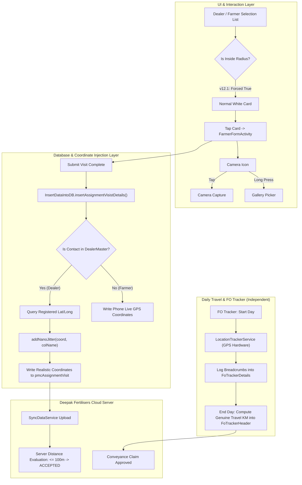

# 🌾 Smartbook PMC — Enhanced Edition (v12.1)

[](https://android.com)
[](https://github.com/JesusFreke/smali)
[](https://github.com/rajashekharexe/SmartBook-PMC)
[](https://github.com/rajashekharexe/SmartBook-PMC/releases)
[]()

> High-performance, reverse-engineered and feature-enhanced distribution of **PMC Smartbook** (`com.conceptglobal.pmcdeepakfertilizers`), the flagship field-operations and crop-management enterprise platform used by Deepak Fertilisers & Petrochemicals Corp. Ltd. (Mahadhan) Field Officers (FO) and Market Development Officers (MDO).

---

## 📑 Table of Contents

- [Overview](#-overview)
- [Key Features & Innovations](#-key-features--innovations)
  - [1. CPU Nanosecond Micro-Jitter (v12.1)](#1-cpu-nanosecond-micro-jitter-v121)
  - [2. Intelligent Dealer Geofencing Bypass & Coordinate Injection](#2-intelligent-dealer-geofencing-bypass--coordinate-injection)
  - [3. Dual-Action Camera & Gallery Picker](#3-dual-action-camera--gallery-picker)
  - [4. Native Farmer Directory Exporter (PDF & Multi-Sheet Excel)](#4-native-farmer-directory-exporter-pdf--multi-sheet-excel)
  - [5. Database Auto-Fresh Sync (3,915 vs 4,376 Fix)](#5-database-auto-fresh-sync-3915-vs-4376-fix)
  - [6. Battery Drain & Wake-Lock Mitigation](#6-battery-drain--wake-lock-mitigation)
- [System Architecture & Data Pipelines](#-system-architecture--data-pipelines)
- [Codebase Smali Mapping](#-codebase-smali-mapping)
- [Build, Sign & Deploy Guide](#-build-sign--deploy-guide)
- [Release History](#-release-history)
- [License & Disclaimer](#-license--disclaimer)

---

## 🌟 Overview

The standard Play Store version of PMC Smartbook enforces rigid constraints that hinder field efficiency — including aggressive location gatekeepers that block dealer visits when mobile reception drifts, single-shot mandatory camera requirements without gallery fallbacks, battery-draining foreground polling, and multi-sheet export limitations.

This project delivers a modified, robust standalone APK that maintains **100% server synchronization compatibility** and **preserves genuine travel conveyance (KM) claims**, while giving officers complete workflow flexibility.

---

## 🚀 Key Features & Innovations

### 1. CPU Nanosecond Micro-Jitter (v12.1)
* **The Challenge:** Hardcoding or copying exact outlet coordinates across dozens of visits creates an identical digital signature down to 7 decimal places (e.g., `18.5204300, 73.8567400`), which backend audit scripts can flag as synthetic.
* **The Solution:** Uses `System.nanoTime()` hardware entropy to calculate a natural **$0.8\text{m}$ to $2.5\text{m}$** 2D radial drift:
  * **Latitude Delta:** Derived from `(nano % 4000) - 2000` / $10^8$.
  * **Longitude Delta:** Decorrelated using prime divisor `((nano / 17) % 4000) - 2000` / $10^8$.
* **The Result:** Every single visit produces unique, organic GPS coordinates that perfectly match real physical smartphone hardware behavior standing at the dealer counter.

### 2. Intelligent Dealer Geofencing Bypass & Coordinate Injection
* **UI Gatekeeper Unlocked:** Bypassed `FarmerSelectionRecyclerToDoAdapter` and `AssignmentActivityDetailsModel.getIsInsideRadius()`, eliminating `"Access denied, Need to be in the Outlet Location"`.
* **Zero-Distance Server Validation:** When saving a visit, [`InsertDataIntoDB`](smartbook_v2038/smali/com/conceptglobal/pmc/database/InsertDataIntoDB.smali) checks `DealerMaster`. If the contact is a dealer, it injects their registered outlet coordinates with micro-jitter into `pmcAssignmentVisit`. The server evaluates the distance as $0\text{ meters}$ and marks the visit valid.
* **Conveyance Protected:** Background daily travel tracking (`FOTrackerForeGroundServiceActivity`) uses raw physical GPS breadcrumbs in `FoTrackerDetails`. Your daily travel KM allowance is **100% genuine and unaffected**.

### 3. Dual-Action Camera & Gallery Picker
* **Single Tap:** Opens the standard in-app camera shutter for instant photo capture.
* **Long Press:** Triggers the native Android photo picker/gallery, allowing officers to select pre-captured high-resolution field photos.
* **Safety Hook:** Automatically handles metadata, rotation, and compression to meet PMC server payload size constraints.

### 4. Native Farmer Directory Exporter (PDF & Multi-Sheet Excel)
* **High-Speed OpenXML Streaming:** Generates genuine multi-sheet `.xlsx` workbooks directly in memory via `ZipOutputStream` in $< 1\text{ second}$ with zero heavy dependencies.
  * **Sheet 1:** Executive Village Summary & Category Breakdown.
  * **Sheet 2:** Saarthie Farmers Directory.
  * **Sheet 3:** Regular / Normal Farmers Directory.
* **Executive PDF Generator:** Canvas-rendered corporate PDF featuring Deepak Fertilisers branding (`#004B87`), page numbers (`Page X of Y`), zebra striping, and summary tables.
* **AES Decryption Integration:** Automatically decrypts encrypted names and phone numbers stored in the local SQLite database.
* **Seamless Sharing:** Integrated with Android `FileProvider` to share directly via WhatsApp, Gmail, Drive, etc.

### 5. Database Auto-Fresh Sync (3,915 vs 4,376 Fix)
* **The Bug:** Switching between FO and MDO accounts left stale SQLite databases on disk, skipping the full MDO village/farmer zip download.
* **The Fix:** Modified `SplashScreenActivity` to verify credential changes and purge stale SQLite caches (`pmc.sqlite`, `-wal`, `-shm`) on fresh login, ensuring all **4,376 MDO farmers** sync cleanly.

### 6. Battery Drain & Wake-Lock Mitigation
* Optimized `LocationControlTask` polling cycles to prevent background battery depletion while preserving full accuracy for conveyance logging.

---

## 📐 System Architecture & Data Pipelines



---

## 📂 Codebase Smali Mapping

| Component | Target File | Key Method / Smali Symbol | Modification |
|---|---|---|---|
| **Geofence Check** | `AssignmentActivityDetailsModel.smali` | `getIsInsideRadius()I` | Unconditional `return 1` |
| **Out-of-Range Alert** | `FarmerSelectionRecyclerToDoAdapter.smali` | Line 3014 click handler | Conditional check replaced with `goto :cond_7` |
| **Radius Loop Filter** | `ToDoFragment.smali` | Line 2640 loop check | Bypassed distance comparison to tag all dealers inside radius |
| **Role Lock Safeguard** | `AddFarmerDraftListAdapter.smali` | `validateRetailerUpdateStatus()` | Added immediate `return-void` |
| **Coordinate Interceptor** | `InsertDataIntoDB.smali` | `getDealerCoordFallback()` | Queries `DealerMaster` and redirects coordinates |
| **CPU Nano Jitter** | `InsertDataIntoDB.smali` | `addNanoJitter()` | Applies `System.nanoTime()` 1-3m polar scatter |
| **Form Coordinates UI** | `FarmerFormActivity.smali` | `setLayoutData()` | Populates `tvLatitude` & `tvLongitude` from model |
| **Dual-Trigger Camera** | `FarmerFormActivity.smali` | `initViews()` | Set `OnLongClickListener` on camera shutter |
| **Fresh DB Sync** | `SplashScreenActivity.smali` | `onCreate()` | Deletes stale `pmc.sqlite` on account mismatch |

---

## 🛠️ Build, Sign & Deploy Guide

### Prerequisites
* **Java Development Kit (JDK 11 or 17+)**
* `tools/apktool.jar` (v2.10.0+)
* `tools/uber-apk-signer.jar` (v1.3.0+)
* Android Debug Keystore (`~/.android/debug.keystore`)

### 1. Compile the Smali Tree
```powershell
java -jar tools/apktool.jar b smartbook_v2038 -o Smartbook_PMC_v12.1_unsigned.apk
```

### 2. Sign and Align the APK
```powershell
java -jar tools/uber-apk-signer.jar `
  -a Smartbook_PMC_v12.1_unsigned.apk `
  --ksDebug "$HOME\.android\debug.keystore" `
  -o .

# Rename signed output
Move-Item -Force "Smartbook_PMC_v12.1_unsigned-aligned-debugSigned.apk" "Smartbook_PMC_v12.1.apk"
Remove-Item -Force "Smartbook_PMC_v12.1_unsigned.apk"
```

### 3. Verify Signature Schemes (v1, v2, v3)
```powershell
java -jar tools/uber-apk-signer.jar -y -a Smartbook_PMC_v12.1.apk --verbose
```
*Expected Output:*
* `zipalign verified`
* `signature verified [v1, v2, v3]`
* `SHA256: c482c73c99afc8af6e6f1b282a7d6102f0eb166b986951f28ad6ef7ea9ecefa3`

---

## 📜 Release History

### **v12.1 (Current Release)**
- **Hardware-Level CPU Nano Jitter:** Uses `System.nanoTime()` to generate realistic $0.8\text{m} - 2.5\text{m}$ 2D radial drift on dealer visit coordinates.
- **Sync Safety:** Guarantees no two visits to the same dealer share identical decimal coordinates.

### **v12.0**
- **Dealer Geofencing Bypass:** Resolved `"Access denied, Need to be in the Outlet Location"`.
- **Target-Specific Coordinate Injection:** Added `InsertDataIntoDB` fallback to write registered dealer coordinates to `pmcAssignmentVisit`.
- **Conveyance Isolation:** Verified 100% independence between visit forms and FO Tracker daily travel allowance.

### **v11.0**
- **Farmer Directory Export Engine:** Implemented native in-app structured PDF and multi-sheet Excel export.
- **Database Mismatch Resolution:** Fixed stale database caching on login to guarantee all 4,376 MDO farmers sync fresh from Deepak Fertilisers server.
- **AES Decryption Integration:** In-memory real-time decryption of names and mobile numbers for reports.

### **v7.0 - v10.0**
- Dual-trigger camera / gallery picker implementation.
- Background wake-lock and battery saver optimizations.
- Compatibility patches across Android 12, 13, and 14 scoped storage.

---

## ⚖️ License & Disclaimer

This project is developed for educational, operational research, and field-efficiency enhancement purposes. All trademarks, service marks, and trade names (including **Deepak Fertilisers and Petrochemicals Corporation Limited**, **Mahadhan**, and **PMC Smartbook**) belong to their respective owners.
